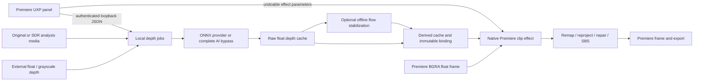

# Architecture

## Boundaries



The worker never supplies output color to the effect. It only decodes analysis frames, produces depth and writes cache files. Original Premiere color is reprojected without exposure, gamut, transfer or tone-map operations. Interpolation is performed in the representation supplied by the host; linear-light resampling and alpha interpretation must be checked during color validation. No claim of HDR delivery certification is made.

The default native core has no third-party dependencies. It is the CPU reference renderer and SDK-independent test surface. The Adobe adapter only handles registration, parameter translation, frame layout, time lookup, cache lookup and error translation. No exceptions cross the Adobe ABI. Input and output row strides are respected. The initial adapter accepts Premiere float BGRA only, requests that pixel format explicitly, and rejects interlaced fields.

## Rendering

1. With slot zero, call the authenticated render service for cached/generated AI depth or registered external depth. Positive slots read prepared float depth and must match override state.
2. Apply depth settings independently of color. A fixed clip normalization range avoids framewise pumping.
3. Remove fully transparent host canvas margins from the input before inference/reprojection; retain actual black picture pixels. Resample external/prepared depth to the picture dimensions. Do not blindly crop the center half for Full SBS.
4. Forward-splat each source sample to both horizontal eye locations. A near-wins depth buffer handles competing surfaces. Equal-depth subpixel contributions are weighted.
5. Retain visibility masks, reconstruct holes and pack/resample each eye. Fit or Fill each packed eye independently into the host output canvas, preserving the Half-SBS squeeze and avoiding sampling across the eye seam.
6. Write float BGRA to the host; translate failures to a visible effect error.

The CPU reference allocates per request. The native CUDA renderer reuses device scratch buffers; the render service holds a bounded 128 MiB depth-plane LRU. There is no real-time 4K performance claim. A bounded CPU/GPU frame LRU, cancellation inside expensive loops, reusable scratch storage and SIMD/tiled processing remain performance work.

## Automatic render service

`depth_bridge.cpp` starts the workspace worker if needed and sends model-sized RGB analysis frames to `/v1/render/depth`. The worker hashes frame pixels and inference settings, writes checksummed depth atomically, and returns raw float depth plus a fixed normalization range. Stereo settings never enter inference identity. `/v1/render/register-external` stores a selected path under a persistent numeric ID; `/v1/render/external` resolves frames using rational host time. Selection uses a native Windows file dialog, not UXP.

## GPU boundary

`gpu.hpp` uses opaque pointers, dimensions, byte pitches, and caller-provided stream handles. CUDA kernels implement depth remap, separable bilateral passes, a two-pass visibility/splat warp, fast repair and packing. Scratch buffers belong to the caller. There are no full-resolution CPU round trips inside those kernels.

The effect calls `runtime_renderer.cpp` and `runtime_kernels.cu` through NVRTC/CUDA Driver API. It uploads host float color once and downloads the packed result once. Fast/Off repair, High background seeding/exemplar repair and diagnostic previews run on CUDA. These kernels are not integrated with the Adobe GPU extension. They must eventually use Premiere's chosen device/context with suites controlling access, lifetimes, synchronization and device memory. See [Adobe GPU initialization/fallback guidance](https://ppro-plugins.docsforadobe.dev/gpu-effects-transitions/getting-started/).

GPU temporal filtering, GPU depth-cache residency, expanded CUDA/CPU parity and PrGPUFilter registration remain to be implemented/validated. The current CUDA renderer is accelerated but uses the Adobe CPU frame entry point and explicit transfers.

The current offline worker decodes/preprocesses source frames on CPU, sends only model-sized tensors to ONNX and downloads a depth plane for persistent caching. It is not a zero-copy NVDEC pipeline. Future providers may use CUDA preprocessing, I/O binding and a shared stream, then upload only cached depth in the host path.

## Model contract

Provider exposes `key` and `infer(rgb_uint8) -> H×W float32 inverse-depth`. `OnnxDepth` validates the manifest's SHA-256, input rank/dtype/dynamic shape and output shape. Model identity includes weights, manifest, preprocess revision, quality, execution device and ORT version. This avoids reusing frames generated by a materially different backend.

`VideoDepth` implements the official Video Depth Anything streaming network through local PyTorch, with Small/Base/Large architecture configs and a metric-distance conversion option. It marks itself stateful, uses source-code and checkpoint checksums, pads/resizes to bound inference geometry, and resets the upstream feature state at large shot changes. On a partial/corrupt cache, the worker replays from source frame zero to reconstruct temporal context. A verified complete cache skips inference entirely. Small relative is the tested checkpoint. CUDA PyTorch is required for RTX execution.

`DA3Depth` creates the requested upstream architecture from its YAML config, strictly loads safetensors, and converts positive distance to nearness. It runs single-view inference, not the separate DA3-Streaming alignment pipeline. `catalog.py` exposes all 17 choices with installed/validation status and official on-demand weight downloads. The panel defaults to DA-V2 Large; the worker never changes architecture based on the resolution preset. Provider changes enter cache identity, while native Invert Depth Map and stereo adjustments do not.

## Cache format

```text
cache-root/
  worker.lock
  entries/<64-lowercase-hex-sha256>/
    000000000.s3d
    000000001.s3d
    manifest.json
  bindings/1.txt
  jobs/<32-hex-job-id>.json
```

An `.s3d` file is a 24-byte little-endian header followed by contiguous row-major little-endian float32 depth, top row first:

| Offset | Type | Meaning |
|---:|---|---|
| 0 | 4 bytes | `S3D1` |
| 4 | uint32 | Version = 1 |
| 8 | uint32 | Width |
| 12 | uint32 | Height |
| 16 | uint32 | Scalar type = 1 (float32) |
| 20 | uint32 | CRC32 of payload |
| 24 | float32[W×H] | Depth |

The cache accepts finite depth values outside 0..1, including metric EXR samples. Dimensions, payload size and CRC are validated in Python and C++. Frames are written to unique temporary siblings, flushed and atomically renamed. Readers see old or new complete frames. Windows sharing violations are retried for a bounded interval. Completion metadata is published only after all frame checks pass. There is one worker process per root and one active job per worker.

Binding file whitespace-separated fields:

```text
S3DB1
<key>
<fps numerator>
<fps denominator>
<frame count>
<width>
<height>
<external: 0|1>
<normalization low>
<normalization high>
```

Slot 0 selects automatic AI/direct external rendering. Slots 1..999999 are not reused for unrelated keys. Clearing an entry retains its binding, so old projects fail on missing data rather than pick another clip. Cache paths are validated; clear deletes only known direct entry files after checking containment and rejecting links/subdirectories. Root selection is fixed at worker startup.

Raw identity hashes source file contents (all sequence members), sampling, model/generation settings and explicit external source offset. No stereo strength, convergence, gamma, contrast or output format appears in it. Stabilized entries hash raw identity + temporal parameters + algorithm version. Changing temporal settings still loads the model manifest to identify the original provider, but reuses existing raw inference frames.

All frames use rational FPS and source indices. Video PTS is compared with the CFR grid; unsupported VFR fails. Missing image numbers fail. The initial host adapter uses rational time-to-frame arithmetic and an explicit offset, but host trim/reverse/proxy/time-remapping integration remains a release gate.

## Worker API

Base: `http://127.0.0.1:48731/v1`. All routes require `Authorization: Bearer <connection token>`. JSON POSTs are limited to 64 KiB; the binary render request has a separate 13 MiB limit. No shell execution endpoints or wildcard CORS access exist.

| Route | Method | Purpose |
|---|---|---|
| `/status` | GET | Worker version, capabilities, cache root, active job |
| `/jobs` | POST | Submit a single source job |
| `/jobs/<id>` | GET | Progress, errors, immutable completed cache slot |
| `/cancel` | POST | `{ "id": "..." }` cancellation at frame boundaries |
| `/cache/clear` | POST | `{ "key": "..." }` clear one exact entry; blocked during jobs |

Example override job:

```json
{
  "source": "D:/shot/color_0001.png",
  "fps": "24000/1001",
  "depth_override": true,
  "depth_source": "D:/shot/z_1001.exr",
  "channel": "Z",
  "depth_frame_offset": 0,
  "temporal": { "enabled": false }
}
```

Source data can change during hashing/decoding; freeze/close source exports before generation. Detecting mid-job file replacement, quota/eviction, source-media file registration, portable bindings and render-time leases are remaining production work.
